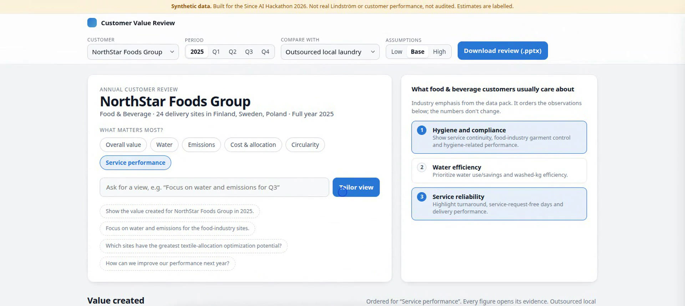
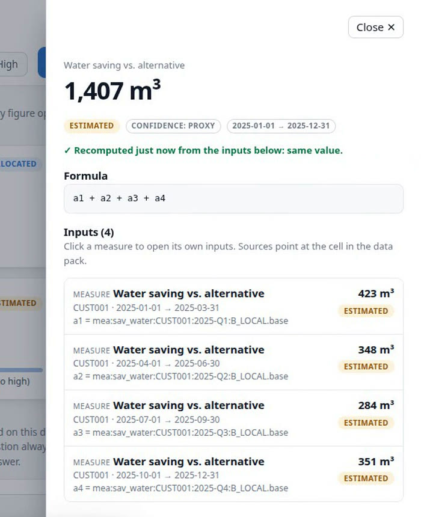
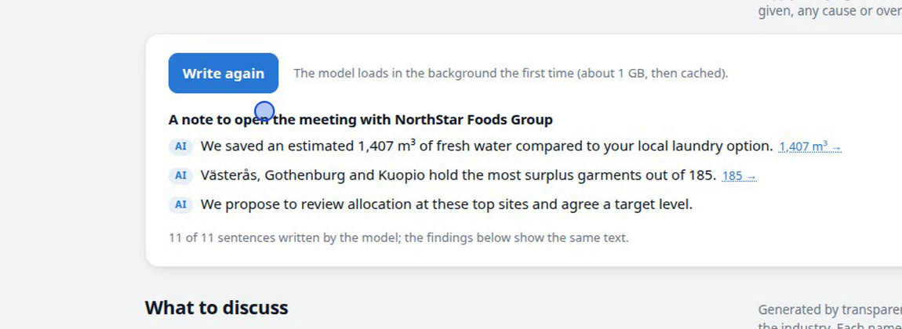

# Customer Value Review

**Every number in a Lindström customer review opens its proof, and the customer-ready deck is one click away.**

Since AI Hackathon 2026, Lindström challenge: *Customer Value & Sustainability Review Generator*.

- **Try it:** https://moesystems.com/demos/lindstrom (runs in the browser; the on-device AI needs a WebGPU browser such as Chrome or Edge)
- **Watch:** [2-minute demo video](https://moesystems.com/demos/lindstrom/Customer_Value_Review_demo.mp4)
- **Read:** [pitch deck (PDF)](https://moesystems.com/demos/lindstrom/Customer_Value_Review_pitch.pdf) · [pilot and continuation plan (PDF)](https://moesystems.com/demos/lindstrom/Customer_Value_Review_pilot_plan.pdf) · [methodology](docs/methodology.md) · [data readiness](docs/data-readiness.md)

> All data comes from the official synthetic data pack. Nothing here is real or audited Lindström or customer performance, and every figure is labelled as such.



## The problem

Every customer asks Lindström one question: *what value did you actually create for us?* Answering it takes days of spreadsheets, and then the customer has to take the numbers on trust. It isn't a reporting problem. It's a proof problem.

## What it does

| Lindström's brief | In Customer Value Review |
|---|---|
| **Traceable calculations** | Every figure opens its evidence: formula, inputs, quarters, sites, down to the exact cell and assumption in the data pack. On start the app recomputes all ~22,000 measures and refuses to start if one doesn't match. Our totals match the pack's own `Customer_Impacts` sheet within 0.05 %. |
| **Personalised analytics** | The customer's industry sets the starting priority (food: hygiene, water, reliability). Priority, period, comparison and free text reorder the review. The numbers never change. |
| **Decision support** | Rules rank the findings; each ends in a question for the meeting, an action to agree on, and its limits. Water, energy and emissions against the realistic alternative, with low / base / high ranges. |
| **Interfaces** | Dashboard with site drill-down, a plain-English question box, and a customer-ready PowerPoint in one click from the same figures. |

<table><tr>
<td width="38%"><br><sub>Every figure opens its formula and inputs, recomputed live.</sub></td>
<td><br><sub>The meeting note, drafted by a model running in the browser. Every figure links to its proof.</sub></td>
</tr></table>

## On-device AI that cannot invent a figure

A small language model (Ternary Bonsai 2, 4B, WebGPU) runs **in the browser on the account manager's own computer** and drafts the three-sentence note that opens the meeting. Customer data never leaves the device.

```
rules pick the findings and supply every figure
   → the model only writes
   → checker (src/pack/narrate.ts) blocks: a figure it wasn't given, an estimate not called one,
     a causal claim, an overclaim, a site outside the facts
   → page: every figure links to its evidence; after two failures the rules-written sentence is shown, marked "Rules"
```

Measured with `scripts/review-ai-eval.mjs` (3 customers × 3 priorities, Radeon 890M, ~23 tokens/s): **96 of 98** model-written sentences passed. The two it stopped had used an estimate without saying so.

Questions in the question box are answered **without** a generative model: a small embedding model (bge-small, CPU) picks one of ~25 intents, and the answer is composed from the review's own figures with links to the evidence. Questions the data can't answer (prices, forecasts, other customers, causes) are refused honestly, naming the Lindström module that would answer them. On 39 blind questions: 77 % right intent, vs. 56 % for keywords alone (`scripts/answer-eval.ts`).

## Run it

Node 22.18 or newer.

```bash
npm install
npm run ui        # http://localhost:5173 — refuses to start if any figure fails to recompute
npm run check     # typecheck + 70 tests + verify (recompute everything, reconcile with the pack)
npm run pack      # NorthStar's headline figures and the reconciliation table
npm run static    # server-less build into site/
npm run models    # download the model weights once, for a fully offline demo
```

Use an approved export instead of the synthetic pack: `CVR_PACK=/path/to/export.xlsx npm run ui` (same sheet and column names; missing sheets or columns stop the load with a clear message, unmapped rows are counted, not dropped).

## How it is built

TypeScript on Node 22, no framework.

```
src/pack/read.ts      xlsx → typed rows (ExcelJS), every value keeps its sheet and cell
src/pack/build.ts     ledger: Excel cell → source → site-month → site/customer, quarter/year; footprint and handprint
src/ledger.ts         measures with formulas; recompute and compare (1e-9)
src/pack/view.ts      the customer view: priorities, findings, comparisons, status labels
src/pack/answer.ts    question intents and honest refusals
src/pack/narrate.ts   the checker for model-written sentences
src/pack/deck.ts      the PowerPoint (PptxGenJS), speaker notes name each figure's measure
src/server.ts         zero-dependency HTTP server; src/static/ builds the same app without a server
web/                  dashboard (index.html, dashboard.js), intent.js (embeddings), narrate.js (WebGPU model)
```

Status labels: **Synthetic** (summed from the pack), **Calculated** (ratios of those), **Allocated** (laundry figure shared by washed kg), **Estimated** (depends on an assumption). A result takes the least certain label of its inputs, so an estimate can never pass as a measurement. Details in [docs/methodology.md](docs/methodology.md); what real data would need, field by field, in [docs/data-readiness.md](docs/data-readiness.md).

## Credits

Ternary Bonsai 2 by PrismML and its WebGPU engine (Apache-2.0, see `web/vendor/BONSAI-*`); Transformers.js by Hugging Face (Apache-2.0); PptxGenJS; ExcelJS. Demo narration voiced with ElevenLabs.
